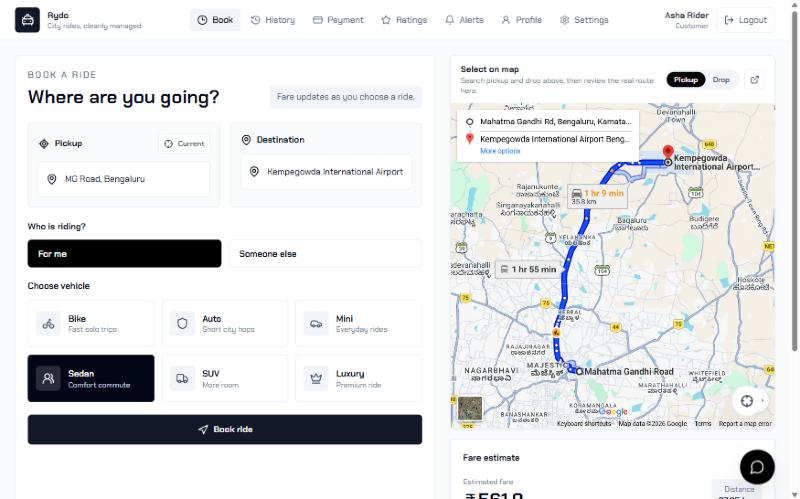
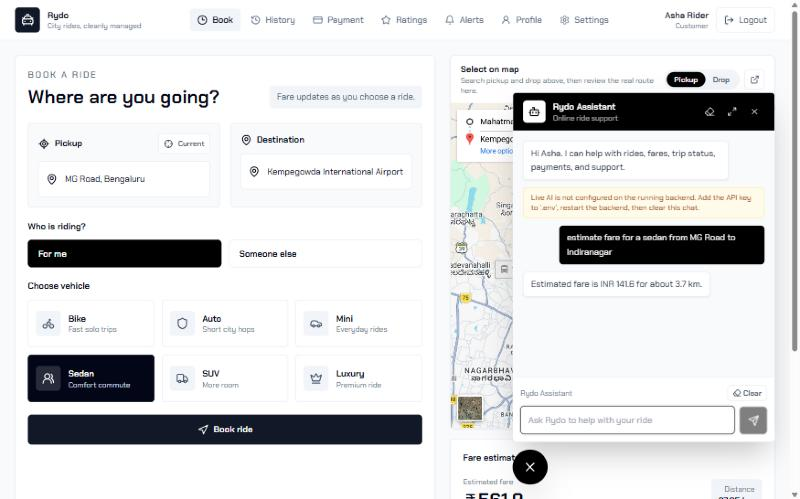
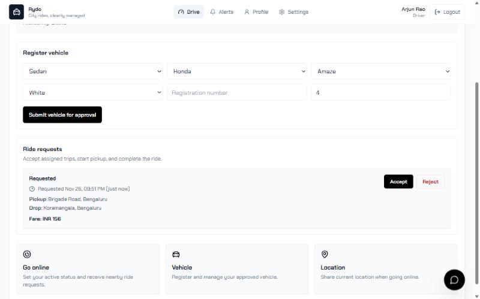
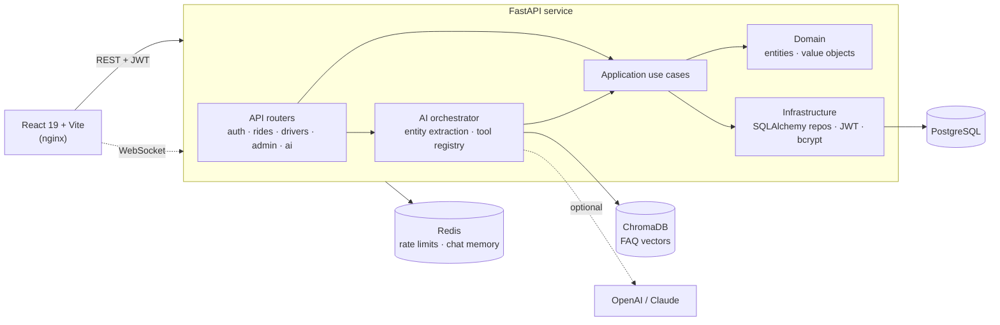

# Rydo — AI-assisted ride booking platform

[](https://github.com/kavyaGN/Rydo/actions/workflows/ci.yml)


A full-stack ride-hailing platform for riders, drivers and admins: book a ride on a live map,
get matched with the nearest approved driver, track the trip, pay and rate — or just tell the
AI assistant *"book a bike from Koramangala to HSR Layout"* and it does it.

| Book a ride | AI booking assistant | Driver dashboard |
| --- | --- | --- |
|  |  |  |

## Run it in one command

```bash
docker compose up --build
```

| What | Where |
| --- | --- |
| Web app | http://localhost:5173 |
| API docs (Swagger) | http://localhost:8000/docs |

Migrations run and demo data is seeded automatically. Sign in with any demo account
(password `Demo@12345`):

| Role | Email |
| --- | --- |
| Rider | `rider@rydo.dev` |
| Driver (sedan / bike / auto) | `driver.sedan@rydo.dev`, `driver.bike@rydo.dev`, `driver.auto@rydo.dev` |
| Admin | `admin@rydo.dev` |

Then prove the whole system works end to end:

```bash
pip install httpx && python -m scripts.smoke_test
```

It books a ride as the rider, accepts/starts/completes it as the driver, then pays and rates —
the same check CI runs against the full Docker stack on every push.

## What it does

**Riders** search pickup/drop on a map, compare vehicle types with live fare estimates, book,
track the trip, pay and rate. **Drivers** go online/offline, register vehicles, and accept,
start and complete assigned rides. **Admins** approve drivers and vehicles.

**AI assistant.** Natural-language requests ("estimate fare for a sedan from MG Road to
Indiranagar") are parsed into intents and entities, then executed through the same use cases
as the UI. Common intents run on a deterministic path, so the assistant books rides and quotes
fares **without any LLM key**. With an OpenAI or Anthropic key it adds LLM tool-calling,
FAQ answers via RAG over ChromaDB, and conversation memory in Redis.

## Architecture



The backend follows a layered (clean) architecture: routers stay thin, business rules live in
use cases and domain services, and persistence sits behind repositories. The AI layer calls the
**same use cases** as the REST API, so a ride booked by chat obeys exactly the same rules as one
booked in the UI. More detail in [docs/architecture.md](docs/architecture.md).

## Engineering highlights

- **Auth:** JWT access tokens plus rotating refresh tokens stored server-side; role-based
  access for rider, driver and admin.
- **Rate limiting:** Redis-backed limits on login, register and refresh (`429` + `Retry-After`),
  shared across every worker; it fails open if Redis is down instead of locking users out.
- **Observability:** every response has an `X-Request-ID`, and every log line is structured
  JSON carrying that ID plus method, path, status and latency.
- **Data:** PostgreSQL with Alembic migrations and database-level `CHECK` constraints on
  statuses, coordinates and capacities.
- **Matching and pricing:** nearest approved online driver by haversine distance; per-vehicle
  base fare plus per-km pricing.
- **Testing:** unit tests for pricing, auth tokens, rate limiting, request tracing and the AI
  orchestrator, plus an end-to-end smoke test of the full ride lifecycle.
- **CI (GitHub Actions):** lint (ruff), tests with coverage, a type-checked frontend build, and
  an E2E job that boots the full Docker stack and drives a real ride through the API.
- **Frontend:** React 19, TypeScript, TanStack Query, Zustand, react-hook-form + zod, and
  route-level code splitting.

## Tech stack

| Layer | Tools |
| --- | --- |
| API | Python 3.13, FastAPI, Pydantic v2, SQLAlchemy 2, Alembic, Gunicorn/Uvicorn |
| Data | PostgreSQL 17, Redis 8, ChromaDB |
| AI | OpenAI / Anthropic (pluggable provider), RAG, tool calling |
| Web | React 19, TypeScript, Vite, Tailwind CSS, TanStack Query, Zustand |
| Ops | Docker Compose, nginx, GitHub Actions, ruff, pytest |

## Local development without Docker

```bash
python -m venv .venv && source .venv/bin/activate   # Windows: .venv\Scripts\activate
pip install -r requirements-dev.txt
cp .env.example .env            # point POSTGRES_HOST / REDIS_HOST at your services
alembic upgrade head && python -m scripts.seed
uvicorn app.main:app --reload

cd frontend && npm ci && npm run dev
```

Checks:

```bash
ruff check app tests scripts
pytest --cov
```

To enable live LLM features, set `OPENAI_API_KEY` (or `ANTHROPIC_API_KEY` with
`AI_DEFAULT_PROVIDER=claude`) in `.env`.

## Project layout

```
app/
  api/v1/endpoints/   HTTP + WebSocket routes (thin)
  application/        use cases and DTOs
  domain/             entities, value objects, repository interfaces
  infrastructure/     SQLAlchemy models/repos, JWT, password hashing
  services/           fare calculation, ride matching, notifications
  ai/                 providers, tool calling, RAG, memory, agents
  core/               settings, logging, rate limiting, request tracing
alembic/              database migrations
scripts/              seed data, end-to-end smoke test
frontend/             React app (Dockerised with nginx)
tests/                unit tests
```

## What I'd do next at scale

- Move driver locations to PostGIS (or Redis GEO) with spatial indexes for sub-millisecond
  nearest-driver queries.
- Publish ride state changes as events (Redis Streams or Kafka) and fan them out to WebSocket
  subscribers across API replicas.
- Add surge pricing driven by live supply and demand per geohash cell.
- Add idempotency keys on booking and payment endpoints to make client retries safe.
- Add OpenTelemetry tracing, carrying the existing request IDs through to spans.
