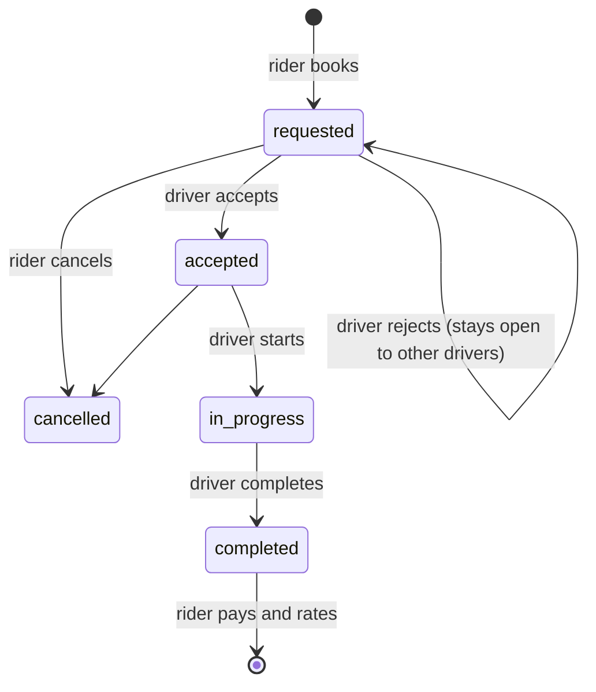
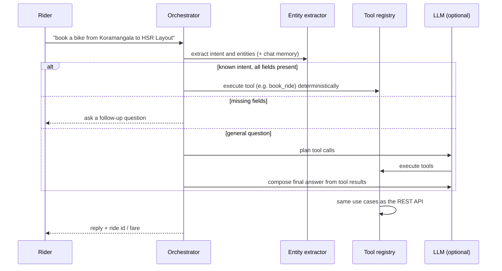

# Architecture

## Layers

| Layer | Folder | Responsibility |
| --- | --- | --- |
| API | `app/api` | HTTP and WebSocket routes, request validation, auth dependencies. No business logic. |
| Application | `app/application` | Use cases such as `LoginUserUseCase` and the ride lifecycle; each one coordinates domain rules and repositories for one action. |
| Domain | `app/domain` | Entities, value objects and repository interfaces. No framework imports. |
| Infrastructure | `app/infrastructure` | SQLAlchemy models and repositories, JWT, bcrypt password hashing. |
| Services | `app/services` | Stateless business services: fare calculation, ride matching, notifications. |
| AI | `app/ai` | LLM providers, tool calling, RAG, conversation memory. |

Dependencies point inward: routers call use cases; use cases depend on interfaces, not on
SQLAlchemy directly.

## Ride lifecycle

Every transition is validated server-side, so a driver cannot complete a ride that was never
started, and a rider cannot rate an unfinished ride.

## AI request flow

**Why a deterministic path first?** Booking and fare quotes are the highest-volume requests and
must be correct, fast and cheap. Handling them without an LLM round-trip makes them predictable
and lets the assistant work without an API key. The LLM handles the open-ended long tail.

**Memory:** follow-up messages are merged with recent chat history, newest first, so
"actually, from HSR Layout" corrects the pickup instead of being ignored.

## Cross-cutting concerns

- **Rate limiting** (`app/core/rate_limit.py`): fixed-window counters in Redis keyed by scope,
  client and window, so limits hold across all workers. It fails open when Redis is unreachable,
  because a cache outage should not take authentication down.
- **Request tracing** (`app/core/request_context.py`): accepts a safe incoming `X-Request-ID` or
  generates one, stores it in a context variable, and a logging filter stamps it on every record.
- **Configuration** (`app/core/settings.py`): typed settings from environment variables via
  pydantic-settings, so the same image runs locally, in CI and in production.
